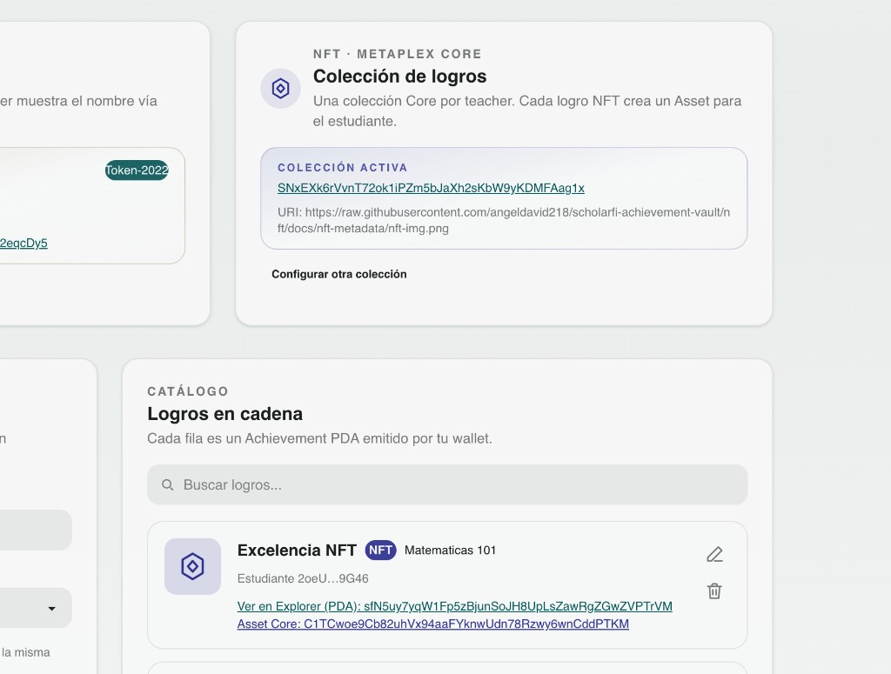
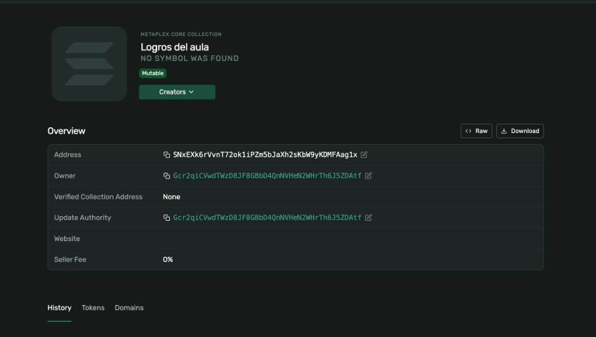
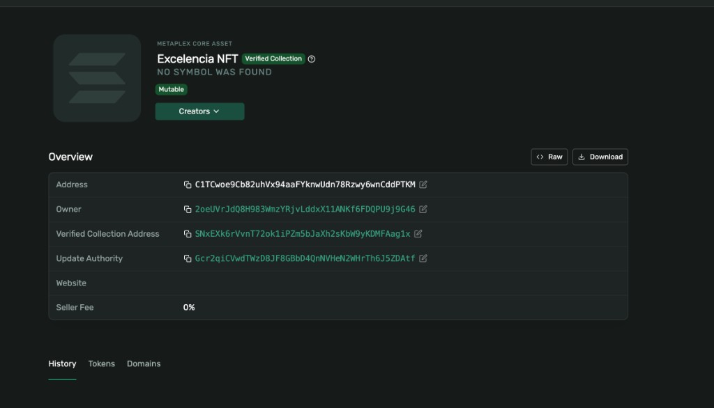

# ScholarFi Achievement Vault

React + Vite frontend for **ScholarFi Lite** on Solana Devnet. Teachers manage a student roster, courses, Token-2022 classroom rewards, and **Metaplex Core NFT achievements**.

- **Branch:** `nft` — Metaplex Core NFT minting
- **Contracts:** [scholarfi-lite-contracts](https://github.com/angeldavid218/scholarfi-lite-contracts) (program `7JTpTv6ftwRJwyXasGjU7L1swFnrizKh7nEeHnSbVMbs`)

## Features

| Area | Behavior |
|------|----------|
| Roster / courses | PDA CRUD against the Anchor program |
| Token achievements | Mint Token-2022 classroom points into the student ATA |
| NFT achievements | Same `register_achievement` tx also creates a **Metaplex Core Asset** for the student |

## Metaplex Core NFT

NFT achievements are **client-side Metaplex Core** mints. The Anchor program is unchanged: it still only stores `AchievementType::Nft` on the Achievement PDA.

When the teacher emits a logro with type **NFT**:

1. The app builds `register_achievement`
2. It appends Metaplex Core `create` (owner = student, payer/authority = teacher)
3. Both instructions go in **one transaction** (teacher + new asset keypair sign)

Each teacher creates a Core **collection** once (saved in `localStorage`). Assets use:

- On-chain `name` from the achievement title
- `uri` from the collection metadata URL
- Plugins: `Attributes` (`achievement_id`, `student`, `teacher`, optional `course_id`) and `PermanentFreezeDelegate` (`frozen: true`)

Off-chain metadata lives in [`docs/nft-metadata/`](docs/nft-metadata/):

- [`metadata.json`](docs/nft-metadata/metadata.json)
- [`nft-img.png`](docs/nft-metadata/nft-img.png)

Public URI (branch `nft`):

```text
https://raw.githubusercontent.com/angeldavid218/scholarfi-achievement-vault/nft/docs/nft-metadata/metadata.json
```

## Setup

```bash
npm install
cp .env.example .env   # if present; or set vars manually
npm run dev
```

Required env:

```env
VITE_PROGRAM_ID=7JTpTv6ftwRJwyXasGjU7L1swFnrizKh7nEeHnSbVMbs
VITE_SOLANA_RPC_URL=https://devnet.helius-rpc.com/?api-key=YOUR_KEY
```

Connect a wallet with Devnet SOL (teacher).

## Happy path (NFT)

1. Start the app (`npm run dev`) and connect the **teacher** wallet on Devnet.
2. **Lista de estudiantes** — create the list if needed and add at least one student wallet.
3. **Colección de logros** (Metaplex Core):
   - Name: e.g. `Logros del aula`
   - Metadata URI: the `metadata.json` raw URL above
   - **Crear colección** and approve in the wallet
4. **Crear logro**:
   - Tipo: **NFT**
   - Nombre: e.g. `Excelencia NFT`
   - Optional course (e.g. Matematicas 101)
   - Assign the student → **Crear y emitir**
5. Confirm in the catalog:
   - Achievement **PDA** Explorer link
   - **Asset Core** Explorer link (student is owner)
6. Open the Asset in Explorer — Metaplex Core, verified collection, freeze/attributes as configured.

Token path (unchanged): create the classroom Token-2022 mint, emit a **Token** achievement with an amount.

Optional CLI smoke (keypair at `~/.config/solana/id.json`):

```bash
node scripts/smoke-nft-core.mjs
```

## Evidence of functionality (Devnet)

End-to-end run from the Achievement Vault UI (`nft` branch):

| Item | Address / note |
|------|----------------|
| Collection | [`SNxEXk6rVvnT72ok1iPZm5bJaXh2sKbW9yKDMFAag1x`](https://explorer.solana.com/address/SNxEXk6rVvnT72ok1iPZm5bJaXh2sKbW9yKDMFAag1x?cluster=devnet) — *Logros del aula* |
| Achievement PDA | [`sfN5uy7yqW1Fp5zBjunSoJH8UpLsZawRgZGwZVPTrVM`](https://explorer.solana.com/address/sfN5uy7yqW1Fp5zBjunSoJH8UpLsZawRgZGwZVPTrVM?cluster=devnet) |
| Core Asset | [`C1TCwoe9Cb82uhVx94aaFYknwUdn78Rzwy6wnCddPTKM`](https://explorer.solana.com/address/C1TCwoe9Cb82uhVx94aaFYknwUdn78Rzwy6wnCddPTKM?cluster=devnet) — *Excelencia NFT* |
| Student (owner) | `2oeUVrJdQ8H983WmzYRjvLddxX11ANKf6FDQPU9j9G46` |
| Update authority (teacher) | `Gcr2qiCVwdTwzD8JF8GBbD4QnNVHeN2WHrTh6J5ZDAtf` |







## Stack

- React 19 + Vite + TypeScript + Tailwind / daisyUI
- `@coral-xyz/anchor` + `@solana/web3.js` + wallet-adapter
- `@metaplex-foundation/mpl-core` + Umi (instruction builders only; wallet sends the tx)
